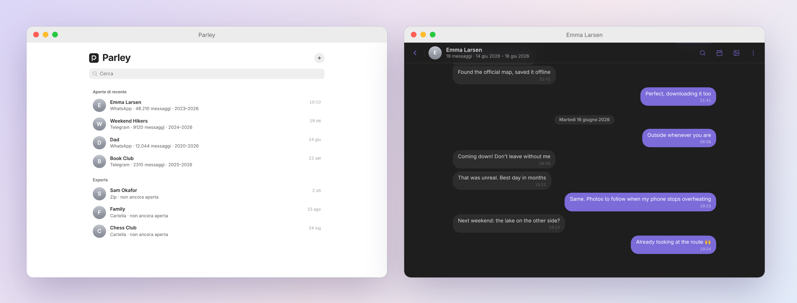

<p align="center">
  
</p>

<h1 align="center">Parley</h1>

<p align="center">
  Reread your exported WhatsApp and Telegram chats inside Obsidian, like a chat app, with photos, voice notes and video.<br>
  Reads straight from a folder or <code>.zip</code> on disk. Nothing is copied into your vault.
</p>

<p align="center">
  
</p>

## Why

Chat exports are a pile of `.txt` files and loose media. Parley turns them back into conversations you can scroll, search and browse, without importing anything into your notes. Your archive stays where it is, as plain files.

## Features

- **Reads in place**: point it at a folder or a `.zip`; it never creates notes or files in the vault, and nothing is uploaded.
- **Lazy zip reader**: opens large archives instantly and extracts media only when it scrolls into view.
- **Messages-style reader**: bubbles, day separators, a floating date chip while you scroll, windowed rendering for very long chats.
- **Media**: photos, video, audio and voice notes, documents, links, with a lightbox (arrow keys to move through).
- **Gallery** with separate tabs: Photos and video, GIFs and stickers, Documents, Links.
- **Search** inside a chat (`Cmd/Ctrl+F`) and jump to a date.
- **Home** with your library folders and recent chats, pick "which one am I" per chat.
- Light and dark, follows your Obsidian theme.

## Supported exports

| Source | Formats |
| --- | --- |
| WhatsApp | iOS and Android `.txt` exports (with or without media), as folder or zip |
| Telegram | Desktop export, JSON and HTML |

How to export: WhatsApp, open a chat, More, Export chat, Include media. Telegram Desktop, chat menu, Export chat history.

## Install

Parley is desktop only (Obsidian 1.5.0 or newer).

**Manual**
1. Download `parley-<version>.zip` from the latest release.
2. Unzip into `<vault>/.obsidian/plugins/parley/` so it contains `main.js`, `manifest.json`, `styles.css`.
3. Reload Obsidian and enable Parley under Settings, Community plugins.

**BRAT**: add `Gusions/obsidian-parley` as a beta plugin.

## Usage

Run **Parley: Open** (command palette) or click the ribbon icon. Use **+** to add a chat (folder or zip) or a whole library folder.

| Shortcut | Action |
| --- | --- |
| `Cmd/Ctrl+F` | Search in the chat |
| `Esc` | Close the preview or lightbox (never closes the tab) |
| `Cmd+[` | Back to the home |
| Arrow keys | Previous/next in the lightbox |

## Privacy

Everything happens locally. Parley only reads the paths you choose and keeps a small `data.json` with your recent list and who "me" is per chat. In the spirit of [file over app](https://stephango.com/file-over-app), your chats remain ordinary files you can open with anything.

## Language

The interface is currently in Italian only. English and other locales are planned; contributions welcome.

## Development

```bash
npm install
npm run build   # outputs dist/parley/ and dist/parley-<version>.zip
npm test
```

Layout: `src/parsers.js` (WhatsApp/Telegram), `src/zipreader.js` (lazy zip), `src/reader.js` (chat view), `src/main.js` (plugin, home), `build.js` bundles them into a single `main.js`.

## License

MIT, by [@gusions](https://github.com/Gusions).
